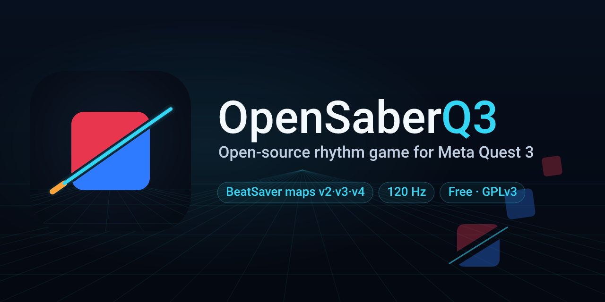

# OpenSaberQ3

Open-source rhythm game for Meta Quest 3. Plays BeatSaver custom maps in v2, v3 and v4 formats at
120 Hz, with an in-VR map browser and BeatLeader scores. A fork of
[BeepSaber](https://github.com/leandrodreamer/BeepSaber).

[](https://github.com/testyfishy/OpenSaberQ3/releases)
[](LICENSE)
[](UPSTREAM.md)
[](https://www.meta.com/quest/quest-3/)



**v0.7.6** — [download the APK](https://github.com/testyfishy/OpenSaberQ3/releases/latest) ·
[install](#download-and-install). Built on BeepSaber and its lineage
([credits](ATTRIBUTION.md), [pinned upstream](UPSTREAM.md)).

## Since the fork

| | BeepSaber upstream (2025-03) | OpenSaberQ3 v0.7.6 |
|---|---|---|
| **Engine** | Godot 4.3; 72 Hz, 60 Hz physics | **Godot 4.6.3**, 120 Hz with physics matched to the display, Performance / Balanced / Quality presets ([perf](docs/performance.md)) |
| **Maps** | v2 | **v2, v3 and v4**, including the hybrid BeatSaver serves and v4's split beatmap/lightshow ([43-map audit](docs/map-data-audit.md)) |
| **Library** | local folders | **In-VR BeatSaver browser** (search, sort, filter, download), a source tag on every map, **filter by source**, automatic backfill ([spec 020](specs/020-libs-leaderboards/spec.md)) |
| **Leaderboards** | none | **BeatLeader** top 10 for the selected map and difficulty, in the menu ([v0.6 report](docs/v0.6-report.md)) |
| **Hit feedback** | one hit sound | Layered hit samples, **L/R audio verified on device**, music ducking, per-event haptics, in-game analyser ([spec 011](specs/011-v03-polish/spec.md)) |
| **Hit registration** | sub-threshold swings dropped | Analytic swept-blade test; a swing that crosses the note is a hit ([spec 006](specs/006-swing-hit-sweep/spec.md)) |
| **Chains** | detached plates, spawn pop-in | Continuous links that span each segment; cut order and score covered by a test ([spec 019](specs/019-chains-dense/spec.md)) |
| **UI and settings** | HUD overlap, scroll stalls | HUD/end-card layout, smooth BeatSaver scrolling, **52 persisted settings** ([spec 016](specs/016-scroll-ui-cleanup/spec.md)) |
| **Measurement** | none | Bot and **human-play** captures, p99/max/spike metrics, release/rollback artifacts ([PERF.md](PERF.md)) |

## What's new

### v0.7.6

- **Batched wall visuals.** All live wall panels draw through one MultiMesh instead of one
  `MeshInstance3D` each. On the wall-heavy map this removes ~54 draw calls at p95, cuts GPU p95 by
  ~3 ms and frame p95 by ~2.5 ms, and drops the worst frame from ~35 ms to ~15 ms. Size, colour,
  rim, grow and fade are per-instance, so the look is unchanged; collision and motion stay on the
  wall nodes.
- **Filled red walls.** The wall material uses the classic red unless the map authors an obstacle
  colour, with 55-100% body alpha; the stale exported-scene cache that kept the old noise shader is
  documented in the build note.
- **Perf instrumentation.** The benchmark records draw calls, objects, render CPU/GPU and the
  wall/lightshow timers, which is how the batch win was measured.

### v0.7.5

- **Walls grow from the floor again.** The bottom edge stays on the ground while a wall rises,
  and ordinary walls get their bright rim back (the V5/V6 look). Noodle, Mapping Extensions and
  off-grid walls keep the flat panel so wall art does not turn into stripes.
- **Cheaper lightshows.** Group events are merged per beat and light type, and fades run five
  interpolation states instead of allocating a tween per event. Hand in Hand drops from 27,669
  box events to 8,022 before play.
- **Arcs start from the head note.** The ribbon uses the spawned cube's own position instead of a
  separate lane calculation, and the first ten mismatches are logged for diagnosis.
- **Device benchmarks.** A `bench.flag` now also runs in release builds, so frame time can be
  measured on the headset without a debug APK.

### v0.7.4

- **Box-group fades and extends.** A box-group event with `i:1` fades to its colour instead of
  snapping on, and `i:2` holds the previous event instead of starting a new one.
- **Groups above id 4 light the room.** Custom environments define their own group ids; they are
  folded onto the room's five lights (`id % 5`) instead of being dropped. The fold is an
  approximation and is logged per map.
- **Cut pieces follow Noodle rotation.** The two halves split along the visible plane when a note
  carries an x/y rotation, instead of using the Euler z.

### v0.7.3

- **Noodle Extensions static transforms.** Notes and walls honour `_position`/`_coordinates`,
  `_rotation` and `_scale`, so placed and scaled objects land where the mapper put them. Animation
  tracks (`_animation`, `AnimateTrack`) and player/camera tracks remain.
- **v4/v3 box-group colours.** `lightColorEventBoxGroups` are converted to the room's basic light
  events: group colour (`c`) and brightness (`s`) at the event beat. Transitions, strobe, filters,
  distributions and groups above id 4 are not modelled.
- **Audio survives idle.** On resume the game re-seats the music stream and pokes the mixer, so a
  suspended app does not come back silent.
- **Above/below hit cue.** Hits are routed through an EQ bus (bright highs above, warm lows below)
  with a small pitch shift, so elevation is audible. This is a spectral cue, not convolution HRTF.
- Chroma per-event colours and the map palette were already supported.

### v0.7.2

- **360/90 lane rotation.** Each object is placed in a lane rotated by the event in force at its
  own beat (v3 `rotationEvents`, v2 types 14/15, v3 basic events 14/15), so notes, bombs, walls,
  arcs and chains come from the sides as the mapper intended while the player turns. Objects already
  in flight keep the lane they spawned in. Early/late events apply at the right beat. v4 per-object
  rotation is not read yet.
- Mapping Extensions precision from 0.7.1 is included.
- Noodle transforms/animation, Chroma events and v4 box-group lighting remain the next slice.

### v0.7.1

- **Mapping Extensions precision.** Notes, bombs, walls, arcs and chains now use the map's precise
  lane/layer coordinates instead of snapping to the 4x3 grid (1000 = lane 0, 2000 = lane 1, each
  step 1/1000 of a lane). Precision cut angles (1000-1360 = 0-360 degrees, 2000-2360
  any-direction), precision wall widths and the 4001+ wall height/start type are decoded too.
  Vanilla maps are untouched.
- 360/90 rotation, Noodle Extensions and Chroma remain the next slices.

### v0.7.0

- **Library cards and sorting.** The main menu has a **Cards** view: All maps, BeatSaver, each
  BeastSaber playlist, BeastSaber (other), Uploaded and Local, with the map count and total size.
  Choose a card to filter the list, then sort by Name, Artist, Mapper, Date added, Size or Play
  count (ascending/descending). The card and sort choice persist across launches.
- **BeastSaber playlists are remembered.** A playlist manifest (`Songs/.playlists.json`) records
  which download belongs to which playlist, many-to-many; this starts with downloads made in 0.7
  or later. Sidecar v2 caches each map's added date and size once (the first 0.7 launch scans the
  folders one time), so later launches do not rescan. Maps downloaded before 0.7 land under
  **BeastSaber (other)** and still play.
- **Depth-based wall grow.** Walls rise from 10% at 16 m to full at 8 m, with height depending on
  depth rather than spawn time, so a wall-art surface stays continuous.
- Map compatibility (Mapping Extensions precision, 90/360, Noodle, Chroma, v4 box groups) is the
  next 0.7.x slice; the policy is in [docs/map-compatibility.md](docs/map-compatibility.md).

### v0.6.5

- **Wall art reads as a wall.** Walls appear at full height immediately (the 1 s grow is gone) and
  the per-wall bright rim is removed, so dense one-lane wall patterns are flat surfaces instead of
  torn, striped curtains.
- **Long arcs stay visible.** The far fade used to start at 15 m from the camera, inside the 16 m
  spawn distance, and the tip fade hid the last 2 m; the far fade now starts beyond 40 m and the tip
  fade is off, so a large gap no longer disappears for a moment.
- **BeatLeader in the high-score panel.** The left panel now has Local and BeatLeader tabs; the
  separate BeatLeader sign that overlapped it is gone, and the menu's Leaderboard button opens the
  tab. The board loads lazily and ignores a response for a map that is no longer selected.
- **Close-cut diagnostics.** A debug-only miss probe records the closest blade-to-box distance for a
  missed note (off in release builds).

### v0.6.4

- **Storage manager.** A **Storage** button in the main menu lists every map with its size and
  source. Tick several and delete them, or pick a source and delete every map from it. Both ask
  with the count and the space first ("Sure? Delete 3 maps (412 MB)").
- **Recursive map delete.** A map folder with subfolders is now removed completely; the old single
  delete only removed top-level files. The shared delete refuses anything that is not a direct
  child of `Songs/`.
- The map's high scores and play counts go with it, matching the existing Delete button.

### v0.6.3

- **Arcs join their notes and use the note colours.** A slider now runs as one smooth curve from
  the head note centre to the tail note centre - no self-crossing loops, no wandering off to the
  side - and it is painted with the map's note palette instead of the room's environment colour.
- **BeatLeader is on your left.** A BeatLeader sign now sits where the BeatSaver panel sits on the
  right; it opens the same read-only top-10 board for the selected map and difficulty.
- **BeastSaber (curated) tab.** The right-hand online panel lists BeastSaber's curated playlists and
  downloads every map in one press, tagged `beastsaber` in the library.
- **Itch media.** A 24-second 1080p60 gameplay clip and four stills are kept locally for the
  store page (not in the repository).

### v0.6.2

- **The screenshot shortcut is both triggers, not grips.** Quest 3 has no usable squeeze input;
  hold both index-finger triggers for half a second **in menus** (during a song, use Pause →
  Screenshot).

### v0.6.1

- **Screenshots from the headset.** In menus, hold both triggers for half a second; during a song,
  press **Screenshot** in the pause menu. 1920×1080 PNGs land in the app's files folder for
  `adb pull`.
- **The bundled demo is gone.** TheFatRat “Time Lapse” is no longer distributed; a library that
  still has the exact bundled copy loses it once.
- **New icon and menu logo**, the sliced-cube mark from `docs/brand/`.

### v0.6.0

- **Every map knows its source.** BeatSaver, uploaded, local or unknown, stored in a sidecar that
  survives upgrades. Filter the library by source from the main menu.
- **Old maps tag themselves.** The level hash is recomputed from the map's files, looked up on
  BeatSaver and written back. Map files are never modified.
- **BeatLeader top 10 in the menu** for the selected map and difficulty. Read-only, no account.
  Maps without a hash show a clear message.
- **Chains are one continuous line.** v0.5.1 removed the spawn animation that shrank every link
  to a dash.
- **Dense maps hold 120 fps.** 2,913 notes at 9.64 NPS: 120 fps median, 0.14% dropped
  (Quest 3, Performance preset, bot play).

The in-VR library filtered to BeatSaver, with source tags and the map details panel.

**Next, 0.6.5:** BeastSaber single-map search and playlist covers. The `beastsaber` tag is already in the
schema.

## Map compatibility

OpenSaber aims to play every BeatSaver map's gameplay faithfully: notes, bombs, walls, arcs,
chains, timing, and the Mapping Extensions, Noodle placement and 360° layouts that change where you
play. Each map shows a compatibility badge (Supported, Partial or Visuals limited), generated from
the map's own declared requirements, and we publish a measured compatibility rate across BeatSaver.
Effects packaged as Unity asset bundles (Vivify, custom environments) are not supported; those maps
still load and play their notes.

- **Supported**: loads, and every scorable note and wall is at the right time and place.
- **Partial**: loads and plays, but a gameplay feature is missing (for example 360° rotation or
  Noodle note movement). The pause menu names what is missing.
- **Visuals limited**: gameplay is correct; lighting, environment or bundled effects are skipped.

**Where 0.7.2 stands:** v2/v3/v4 maps, notes, bombs, walls, arcs, chains, BPM changes, Chroma
per-note colours, basic light events, Noodle `_coordinates` placement (partial), Mapping Extensions
precision, and 90°/360° track rotation. Not yet: Noodle rotation/scale/animation, Chroma light
events, v4 box-group lighting, and Unity asset-bundle effects.

**v0.7 goals:** close the gameplay gaps — Mapping Extensions precision, 90°/360° lane rotation,
Noodle static transforms and animation, per-object note speed/offset, Chroma events, v4 box-group
lighting — and add the measured corpus report. Unity asset bundles are pursued only where an
open-source parser is practical; otherwise the map still loads with a Visuals-limited badge.
Nothing closed-source is required.

[Map compatibility policy and measurement](docs/map-compatibility.md)

## Performance

| | |
|---|---|
| Dense reference map | **Somewhere Out There ExpertPlus**, 2,913 notes, 9.64 NPS |
| Delivered | **120 fps** median, App 5.0 ms, GPU 0.85 of budget |
| Dropped frames | **0.14%** steady, p99 11.4 ms |
| ODDS&ENDS ExpertPlus after the stutter fix | 0.01% dropped (2 frames in 21,348), 76.6% on time, p99 9.97 ms |
| Stress case | Gloom, 12,340 walls: **2.14% dropped**, down from 24% before wall pooling |

*Quest 3, 120 Hz, Performance preset, bot on the real collision path unless noted. Dropped = a
frame that missed a vsync slot (>= 1.5x period); on time = within 1.05x.
[Full results](docs/performance.md).*

## Download and install

The latest signed APK is on the [releases page](https://github.com/testyfishy/OpenSaberQ3/releases).
Enable **Developer mode** on the headset, then sideload with SideQuest or run:

```sh
adb install -r OpenSaberQ3-0.7.6.apk
```

Launch **Open Saber Q3** from *Unknown Sources*. Installs alongside upstream BeepSaber; songs and
scores stay separate. Upgrading over 0.5.x keeps maps, scores and settings. Builds are test-signed,
not store builds. The 0.7.6 APK carries the new icon and menu logo. Screenshots are in
`/sdcard/Android/data/io.github.testyfishy.opensaberq3/files/screenshots/`:

```sh
adb pull /sdcard/Android/data/io.github.testyfishy.opensaberq3/files/screenshots
```

The Quest Files app cannot open `Android/data`; use adb. The first capture in a session can stall
for about a second while the renderer compiles; Pause → Screenshot is the reliable still.

## Documentation

| | |
|---|---|
| [v0.6.0 release report](docs/v0.6-report.md) | Library sources, BeatLeader, device evidence, upgrade test |
| [Performance](docs/performance.md) | Frame-time trace, stutter fix, per-map walls, dense notes |
| [Changelog](docs/changelog.md) | Every release from v0.1.0 to v0.6.0 |
| [v0.3 report](docs/v0.3-report.md) | Feedback, sky, audio and layout |
| [Upstream and toolchain](UPSTREAM.md) | Pinned commit, build steps, reproducibility gaps |
| [Attribution](ATTRIBUTION.md) | Authors and asset provenance |
| [Benchmarking](tools/perf/benchmark.md) | Capture method |

## Build from source

Godot **4.6.3** + JDK 17 + Android SDK 34/36, export preset **`Oculus Quest (RELEASE)`**.

Before exporting, delete `.godot/exported`. Exported scenes embed copies of external materials, and a
stale cache silently keeps old shaders in the APK (this is what kept the old noise wall in 0.7.5).

Versions, commands and known gaps: [UPSTREAM.md](UPSTREAM.md).

## Known limitations

- **Above/below uses a spectral elevation cue** (EQ bus + small pitch), not convolution HRTF.
- **Quest 3 speakers roll off below ~150-200 Hz**, so hit weight sits at 200-800 Hz.
- **Noodle transforms are static** (position, rotation, scale); animation and player tracks are not
  played.
- **v4 per-object rotation** and VFX event boxes are not read. v2/v3 360/90 lanes and box-group
  colour, brightness and fades are supported; box groups ignore strobe, filters, distributions,
  fade-to-black, and fold group ids above 4 onto the room's lights.
- The white highlights at chain joints are cosmetic.

## Credits and license

**Artwork:** logo, icon and banner are AI-generated vector artwork created with AI assistants
(DeepSeek V4 Flash and Claude Opus 5.5) from a design brief, reviewed by the owner; sources,
palette and provenance are in [docs/brand.md](docs/brand.md).

MIT — [LICENSE](LICENSE) retains the original copyright (© 2020 Holger Dammertz). Contains no Beat
Saber assets and does not use the Beat Saber name, logo or branding. Not affiliated with or
endorsed by Beat Games, Meta, BeatSaver or BeatLeader.

