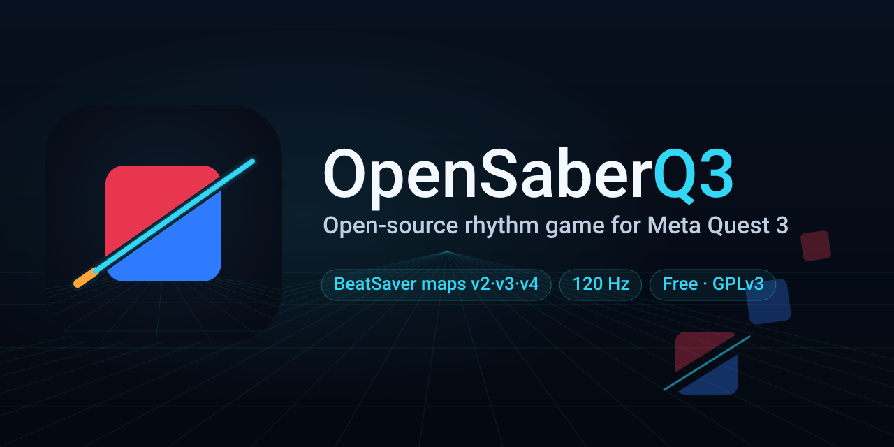

# OpenSaberQ3

Open-source rhythm game for Meta Quest 3. Plays BeatSaver custom maps in v2, v3 and v4 formats at
120 Hz, including animated (Noodle Extensions) maps, with an in-VR map browser and BeatLeader
scores. A fork of
[BeepSaber](https://github.com/leandrodreamer/BeepSaber).

[](https://github.com/testyfishy/OpenSaberQ3/releases)
[](LICENSE)
[](UPSTREAM.md)
[](https://www.meta.com/quest/quest-3/)



**v0.77.1** — [download the APK](https://github.com/testyfishy/OpenSaberQ3/releases/latest) ·
[install](#download-and-install). Built on BeepSaber and its lineage
([credits](ATTRIBUTION.md), [pinned upstream](UPSTREAM.md)).

> [!IMPORTANT]
> **This project is vibe coded.** It was built as a hobby with multiple AI coding agents, from the
> original BeepSaber fork, in the Godot engine. Not every line has been reviewed by a human.

**Feedback:** bugs, map problems and ideas go to
[GitHub Issues](https://github.com/testyfishy/OpenSaberQ3/issues).

## Since the fork

| | BeepSaber upstream (2025-03) | OpenSaberQ3 v0.77.0 |
|---|---|---|
| **Engine** | Godot 4.3; 72 Hz, 60 Hz physics | **Godot 4.6.3**, 120 Hz with physics matched to the display, Performance / Balanced / Quality presets ([perf](docs/performance.md)) |
| **Maps** | v2 | **v2, v3 and v4**, including the hybrid BeatSaver serves and v4's split beatmap/lightshow ([43-map audit](docs/map-data-audit.md)) |
| **Animated maps** | not played | **Noodle Extensions animation**: tracks, point definitions, path animation, parent tracks, dissolve, fake objects ([report](docs/noodle-animation-report.md)) |
| **Note motion** | fixed speed and distance | **The map's own note jump speed and spawn distance**, with the fly-in before the jump ([report](docs/note-motion-report.md)) |
| **Modifiers** | none | **Per-song Note Speed, Strict cuts and No Fail**, with a score multiplier when a song is made easier |
| **Library** | local folders | **In-VR BeatSaver browser** (search, sort, filter, download), a source tag on every map, **filter by source**, automatic backfill ([spec 020](specs/020-libs-leaderboards/spec.md)) |
| **Leaderboards** | none | **BeatLeader** top 10 for the selected map and difficulty, in the menu ([v0.6 report](docs/v0.6-report.md)) |
| **Hit feedback** | one hit sound | Layered hit samples, **L/R audio verified on device**, music ducking, per-event haptics, in-game analyser ([spec 011](specs/011-v03-polish/spec.md)) |
| **Hit registration** | sub-threshold swings dropped | Analytic swept-blade test; a swing that crosses the note is a hit ([spec 006](specs/006-swing-hit-sweep/spec.md)) |
| **Chains** | detached plates, spawn pop-in | Continuous links that span each segment; cut order and score covered by a test ([spec 019](specs/019-chains-dense/spec.md)) |
| **UI and settings** | HUD overlap, scroll stalls | HUD/end-card layout, smooth BeatSaver scrolling, **58 persisted settings** ([spec 016](specs/016-scroll-ui-cleanup/spec.md)) |
| **Measurement** | none | Bot and **human-play** captures, p99/max/spike metrics, release/rollback artifacts ([PERF.md](PERF.md)) |

## What's new

### v0.77.0

The first release since v0.7.5. Everything between is in the
[release notes](https://github.com/testyfishy/OpenSaberQ3/releases) and the
[changelog](docs/changelog.md).

- **Animated maps play.** Noodle Extensions animation is supported: animated tracks, point
  definitions, path animation, parent tracks, dissolve and fake (unscored) objects. Animated maps
  carry an **Animated** badge in the song list, and a filter shows only them or hides them.
- **Notes move the way the map says.** Each difficulty's own note jump speed and spawn distance
  are used. Notes fly in from the distance, then jump, and reach their cut direction early in the
  jump instead of close to the player.
- **Per-song modifiers.** Note Speed, Strict cuts and No Fail are set on the song, not in
  Settings. Making a song easier lowers the score multiplier, shown before you start.
- **Arcs.** An arc follows its curve between its two notes, stays drawn after the first note is
  cut, is drawn over walls, and fades into the distance until its second note arrives.
- **The map's own environment.** When a map removes most of the default room to build its own
  scene, the default room is hidden (Settings, on by default).
- **Smoother dense and animated maps.** Animation is evaluated once per drawn frame and only for
  objects that need it; note, bomb, arc and spark objects are prepared at load. See
  [Performance](#performance).
- **Fixes.** A crash in the map loader, late note rotation, notes appearing too close, and
  stutter when bombs or sparks first appear.

## Map compatibility

OpenSaber aims to play every BeatSaver map's gameplay faithfully: notes, bombs, walls, arcs,
chains, timing, and the Mapping Extensions, Noodle placement and 360° layouts that change where you
play. Each map shows a compatibility badge (Supported, Partial or Visuals limited), generated from
the map's own declared requirements, and we publish a measured compatibility rate across BeatSaver.
Effects packaged as Unity asset bundles (Vivify, custom environments) are not supported; those maps
still load and play their notes.

- **Supported**: loads, and every scorable note and wall is at the right time and place.
- **Partial**: loads and plays, but a gameplay feature is missing (for example 360° rotation or
  Noodle note movement). The pause menu names what is missing.
- **Visuals limited**: gameplay is correct; lighting, environment or bundled effects are skipped.

**Where 0.77.0 stands:** v2/v3/v4 maps, notes, bombs, walls, arcs, chains, BPM changes, Chroma
per-note colours, basic light events, Mapping Extensions precision, 90°/360° track rotation,
per-object note speed and offset, and Noodle Extensions placement, rotation, scale and animation
(tracks, path animation, parent tracks, dissolve, fake objects).

**Not yet:** Chroma environment objects and Chroma light events, Vivify and other Unity
asset-bundle effects, Noodle player (head and hand) tracks and the `time` property, arcs and
chains following an animated head note, and v4 box-group VFX. Those maps still load and play
their notes; the badge and the pause menu say what is missing. Nothing closed-source is required.

[Map compatibility policy and measurement](docs/map-compatibility.md)

## Performance

| | |
|---|---|
| Dense reference map | **Somewhere Out There ExpertPlus**, 2,913 notes, 9.64 NPS |
| Delivered | **120 fps** median, App 5.0 ms, GPU 0.85 of budget |
| Dropped frames | **0.14%** steady, p99 11.4 ms |
| ODDS&ENDS ExpertPlus after the stutter fix | 0.01% dropped (2 frames in 21,348), 76.6% on time, p99 9.97 ms |
| Animated map (v0.7.36) | Somewhere Out There ExpertPlus Lawless: mean 8.8 ms, p99 14.8 ms, 4 frames over 25 ms in the song |
| ODDS&ENDS ExpertPlus (v0.7.39, 60 s) | mean 8.4 ms, p99 10.4 ms |
| Stress case | Gloom, 12,340 walls: **2.14% dropped**, down from 24% before wall pooling |

*Quest 3, 120 Hz, Performance preset, bot on the real collision path unless noted. Dropped = a
frame that missed a vsync slot (>= 1.5x period); on time = within 1.05x.
[Full results](docs/performance.md).*

## Download and install

**Easiest:** install it from [SideQuest](https://sidequestvr.com/app/64313/opensaberq3). It is also on
[itch.io](https://testyfishy.itch.io/open-saber-q3), and the APK is on the
[releases page](https://github.com/testyfishy/OpenSaberQ3/releases).

**Installing the APK yourself:**

1. Turn on **Developer Mode**: Meta Horizon phone app → Devices → your headset → Headset settings →
   Developer mode (needs a free Meta developer account). Restart the headset.
2. Connect the headset to your PC by USB-C, put it on and allow USB debugging.
3. Install with SideQuest (drag the APK onto it) or adb:

   ```sh
   adb install -r OpenSaber-v0.77.1.apk
   ```

4. On the headset: App Library → **Unknown Sources** → **Open Saber Q3**. Allow storage access if asked.

**Getting maps:** use the BeatSaver browser in the menu (no PC needed); or open the "Manually Upload
Custom Songs" address the main menu shows in a browser on a PC on the same Wi-Fi; or unzip a map into
its own folder under `/sdcard/Android/data/io.github.testyfishy.opensaberq3/files/OpenSaber/Songs/`
and press **Refresh Songs/Playlists**.

Quest 3 is the tested headset. It installs alongside BeepSaber and keeps its own songs and scores;
upgrading over an earlier OpenSaberQ3 keeps maps, scores and settings. Builds are test-signed, not
Meta Store builds.

**Screenshots:** triggers in menus, Pause → Screenshot in a song. They are saved under
`/sdcard/Android/data/io.github.testyfishy.opensaberq3/files/screenshots/`; the Quest Files app
cannot open `Android/data`, so use adb:

```sh
adb pull /sdcard/Android/data/io.github.testyfishy.opensaberq3/files/screenshots
```

## Documentation

| | |
|---|---|
| [v0.6.0 release report](docs/v0.6-report.md) | Library sources, BeatLeader, device evidence, upgrade test |
| [Performance](docs/performance.md) | Frame-time trace, stutter fix, per-map walls, dense notes |
| [Changelog](docs/changelog.md) | Every build from v0.1.0 to v0.77.1 |
| [Animated maps](docs/noodle-animation-report.md) | What Noodle Extensions animation is supported, how it is evaluated, measurements |
| [Note motion](docs/note-motion-report.md) | Jump speed, spawn distance, fly-in, modifiers, arcs, comparison with Beat Saber |
| [Map compatibility](docs/map-compatibility.md) | Badges, policy and what is not supported |
| [v0.3 report](docs/v0.3-report.md) | Feedback, sky, audio and layout |
| [Upstream and toolchain](UPSTREAM.md) | Pinned commit, build steps, reproducibility gaps |
| [Attribution](ATTRIBUTION.md) | Authors and asset provenance |
| [Benchmarking](tools/perf/benchmark.md) | Capture method |

## Refresh rate

The default is **120 Hz**; **90 Hz** remains selectable in Settings > Refresh rate. The owner
tested 90 and preferred 120, so the project default and the OpenXR startup rate are 120 Hz again.
A one-time migration moves the previous 90 default back to 120 without blocking a later choice.

## Build from source

Godot **4.6.3** + JDK 17 + Android SDK 34/36, export preset **`Oculus Quest (RELEASE)`**.

Before exporting, delete `.godot/exported`. Exported scenes embed copies of external materials, and a
stale cache silently keeps old shaders in the APK (this is what kept the old noise wall in 0.7.5).

Versions, commands and known gaps: [UPSTREAM.md](UPSTREAM.md).

## Known limitations

- **Above/below uses a spectral elevation cue** (EQ bus + small pitch), not convolution HRTF.
- **Quest 3 speakers roll off below ~150-200 Hz**, so hit weight sits at 200-800 Hz.
- **Animated maps:** player (head and hand) tracks, the `time` property and Chroma environment
  objects are not played; arcs and chains do not follow an animated head note. Vivify maps play
  their notes without the bundled visuals.
- **Mass wall spawns** (hundreds of walls in one beat) can still drop a few frames, and the
  busiest animated stretches run near 105 fps rather than 120.
- **Wall growth, the bad-cut box and the head collision size** differ slightly from Beat Saber
  ([note motion report](docs/note-motion-report.md)).
- **v4 per-object rotation** and VFX event boxes are not read. v2/v3 360/90 lanes and box-group
  colour, brightness and fades are supported; box groups ignore strobe, filters, distributions,
  fade-to-black, and fold group ids above 4 onto the room's lights.
- The white highlights at chain joints are cosmetic.

## Credits and license

**Artwork:** logo, icon and banner are AI-generated vector artwork created with AI assistants
(DeepSeek V4 Flash and Claude Opus 5.5) from a design brief, reviewed by the owner; sources,
palette and provenance are in [docs/brand.md](docs/brand.md).

GPL-3.0 — see [LICENSE](LICENSE). OpenSaberQ3 is a fork of BeepSaber, which is MIT-licensed: its
original notice (© 2020 Holger Dammertz) is kept unmodified in [LICENSE-MIT](LICENSE-MIT) and still
covers the upstream code. Releases up to v0.7.5 were published under MIT and stay MIT. Contains no Beat
Saber assets and does not use the Beat Saber name, logo or branding. Not affiliated with or
endorsed by Beat Games, Meta, BeatSaver or BeatLeader.

