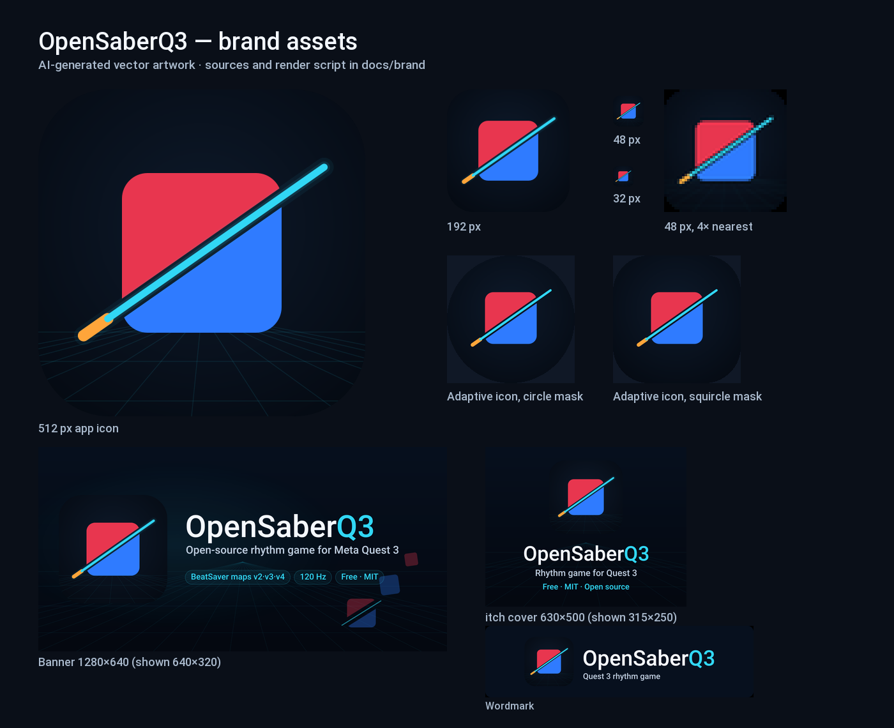

# Brand

The mark is a note cube cut on a 35° swing: red and blue halves separated by a cyan blade, with an
orange hilt at the lower-left end. It says "slice to the beat" without words and reads at 48 px.
The palette is the one the game uses: note red, note blue, saber cyan, hilt orange, deep navy.



## AI provenance

**The logo, app icon, banner and wordmarks are AI-generated vector artwork.** An AI coding assistant
(DeepSeek V4 Flash) wrote the SVG from a design brief by Claude Opus 5.5 (Anthropic), both via
OpenCode. The project owner reviewed the result. No image-generation model, stock image or
third-party artwork was used. The wordmark is set in Roboto Medium and converted to paths; Roboto is Apache-2.0,
© Google.

The sources are the files below. They are committed so the claim can be checked, and so the marks
can be regenerated rather than re-drawn.

## Files

| File | Use |
|---|---|
| `docs/brand/logo.svg` | 512 px app icon master (tile, grid, glow) |
| `docs/brand/logo-small.svg` | 192 px and smaller: no grid, single glow |
| `docs/brand/icon-adaptive-fg.svg` | Android adaptive foreground, 432 px, 264 px safe circle |
| `docs/brand/icon-adaptive-bg.svg` | Android adaptive background, 432 px |
| `docs/brand/banner.svg` | 1280×640 banner (GitHub, README, itch header) |
| `docs/brand/itch-cover.svg` | 630×500 itch cover |
| `docs/brand/wordmark-horizontal.svg` | horizontal lockup on a dark card |
| `docs/brand/wordmark-stacked.svg` | stacked lockup on a dark card |
| `docs/brand/contact-sheet.png` | size and mask proof |
| `docs/images/banner.png` | rendered banner used by the README |
| `docs/images/itch-cover.png` | rendered itch cover |
| `docs/images/logo.png` | rendered 512 px mark |
| `icon.png`, `icon_192.png`, `icon_adaptive_*_432.png` | live app icons |
| `game/data/beepsaber_logo.png` | in-menu logo and boot splash |

## Palette

| Role | Hex |
|---|---|
| Background inner / outer | `#0E1A2B` / `#050A12` |
| Note red | `#E8364F` |
| Note blue | `#2F7BFF` |
| Saber cyan | `#31D7F5` |
| Hilt orange | `#FFA53A` |
| Wordmark white / muted | `#F4F8FF` / `#BFCEE0` |

## Usage

- Minimum size: 32 px for the icon, 48 px when the grid and outer glow are included.
- Clear space around the tile: at least 25% of the tile width.
- Do not add a Beat Saber logo, lettering or a directional arrow to the cube.
- The icon tile may sit on any dark background; the banner and wordmark already carry their own
  panel.
- The 0.6.0 APK still uses the previous icon. The new icon and menu logo ship in 0.6.1.

## Rebuilding

Requires Godot 4.6.3 and Python with `matplotlib` and `Pillow` (only for the SVG text paths and the
contact sheet):

```sh
python docs/brand/build_brand.py
godot --headless --path . -s res://tools/brand/render_brand.gd
python docs/brand/make_contact_sheet.py
```

`build_brand.py` writes the SVGs, `render_brand.gd` rasterises every PNG at its target size, and
`make_contact_sheet.py` draws the review sheet. SVG filters are deliberately avoided: Godot's
ThorVG importer does not render them reliably; the glow is three wide strokes.
