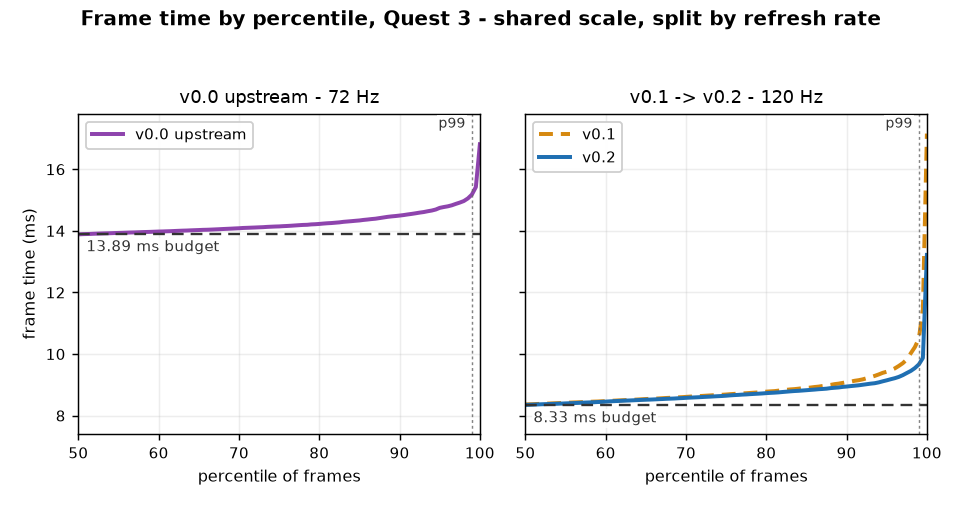

# Performance

Everything here was measured on a Quest 3 at 120 Hz with a signed release build of the commit in
question, bot playing a real map through the real collision path. The full raw log, validity rules
and retractions are in [PERF.md](../PERF.md); the story of the v0.3 fix is in the
[v0.3 report](v0.3-report.md).

## Metrics

- **dropped** — a frame that missed a whole vsync slot (>= 1.5x the frame period). This is the one
  a player feels as a hitch.
- **on time** — a frame delivered within ~1.05x the period. Always the lower number.

Every capture reports both.

## Frame time through a song

X is seconds from the start, y is the interval between consecutive frames. The shaded band is the
min-to-max range within each second, the line through it is the median, the thin line is the
slowest frame in that second, and the **red dots are frames that missed a vsync slot**, drawn when
they happened. The triangles at the top are song-start pipeline compiles, pinned above the axis.

- **v0.1 is clean for about 28 seconds, then drops slots continuously to the end of the song** —
  119 of them.
- **v0.2 has nine in three minutes.** Its median is identical to v0.1's (8.37 vs 8.43 ms); the
  difference is entirely in the tail.

Regenerate with `python tools/perf/plot_frametime.py`.

## Stutter: a physics read in `Cuttable`

`Cuttable._physics_process` read `global_transform` twice per tick per live note. Frame time
climbed 8.40 -> 8.95 ms across three minutes — worse the longer you played.
(PERF.md records the earlier harness-only conclusion and its retraction.)

| | before | after |
|---|---|---|
| on time | 64.3% | **76.6%** |
| dropped | 0.72% | **0.01%** (2 frames in 21,348) |
| p99 | 11.98 ms | **9.97 ms** |
| mean frame, thirds | 8.40 / 8.69 / 8.95 ms | **8.33 / 8.33 / 8.33 ms** |
| on-time, thirds | 78.5 / 62.6 / 51.7% | **81.3 / 75.0 / 73.5%** |

Dropped frames fell 72x and the decay disappeared. Replacing the repeated reads with one local
read is the whole fix.

## The GPU is the limiter

The preset sets the three GPU levers together, because the individual names mean nothing on their
own.

| Preset | Render target | MSAA | Foveation | GPU | On time |
|---|---|---|---|---|---|
| Quality | 2107x2208 (native supersample) | 4x | off | 0.86 | 78.3% |
| Balanced | 1848x1936 | 4x | low | 0.75 | - |
| **Performance (default)** | **1680x1760** (runtime recommended) | **2x** | **medium** | **0.68-0.70** | **76.6%** |

## The map matrix: walls were the hidden cost

Six maps, 90 s each, same bot, same 120 Hz settings. Bombs and arcs are free; density alone is not
the cost.

| map | notes | bombs | walls | arcs | fps | on time | dropped |
|---|---|---|---|---|---|---|---|
| Empires (Ex+) | 823 | 0 | 0 | 0 | 120.0 | 80.5% | 0.00% |
| ODDS&ENDS | - | - | few | - | 120.0 | 78.3% | 0.01% |
| Void Hornet (Ex+) | 657 | 0 | 16 | 6 | 120.0 | 72.0% | 0.00% |
| HEARTATTACK (Ex+) | 2,118 | 575 | 567 | 153 | 120.0 | 71.8% | 0.00% |
| **Gloom (Ex+)** | 411 | 4 | **12,340** | 0 | **92.9** | 27.5% | **24.07%** |
| **Somewhere Out There (Ex+)** | 2,905 | 8 | **3,530** | 0 | **65.1** | 6.2% | **66.29%** |

The two maps that collapsed were the two wall maps: every wall was instantiated and freed, ~74
times a second on Gloom. Walls now come from a `ScenePool` like notes; the dense-map capture below
is the same map at the modern build.

## Dense notes, v0.6

The hardest map in the device library: **Somewhere Out There ExpertPlus, 2,913 notes, 9.64 NPS**,
120 Hz, bot hitting notes.

| run | fps | App | GPU | p99 | dropped | cubes live |
|---|---|---|---|---|---|---|
| steady default | 120 | 5.02 ms | 0.85 | 11.37 ms | **0.14%** | 7 |
| hot (after 180 s of runs) | 120 | 6.01 ms | 0.97 | 12.79 ms | 1.09% | 7 |
| light map (ODDS) | 120 | 4.97 ms | 0.85 | 10.24 ms | 0.11% | 9 |
| debris / glow / flash off | 120 | 5.18-5.22 ms | 0.87 | 10.90-11.60 ms | 0.10-0.27% | 7 |

Feature-off arms do not move the result; spike attribution shows spawn <= 0.9 ms, swing <= 3 ms,
cuttable <= 0.1 ms. The hot-run delta is device/GPU state, not the note stream. That is why the
note path was not changed for v0.6; the [full analysis](../specs/019-chains-dense/spec.md) records
the arms and the conclusion.

## Human play

`[bench] player_capture` records the same CSV while a person plays instead of the bot, and writes
it out when the song ends. Method: [tools/perf/benchmark.md](../tools/perf/benchmark.md).

## What is not achievable

Ray tracing, physics ragdolls, HRTF spatialisation and per-hit music ducking at note rate are not
supported: Godot has no RT API on Quest, and the hardware/audio path cannot deliver the rest.
Sky, reflections and audio ship in the forms Quest 3 runs at 120 Hz.
## 0.7.6 wall-overdraw A/B (Quest 3, 120 Hz)

Map: Somewhere Out There (188 live walls), bot, 60 s per arm, same build. wall_depth=true uses
depth_prepass_alpha; wall_opaque=true removes alpha blending and writes depth.

| Arm | GPU p50 | GPU p95 | frame p95 | draw calls p95 |
|---|---|---|---|---|
| alpha (current) | 7.44 ms | 10.66 ms | 12.90 ms | 315 |
| depth prepass | 7.45 ms | 10.80 ms | 12.49 ms | 315 |
| opaque | 7.46 ms | 15.89 ms | 16.86 ms | 380 |

Neither variant buys time. The prepass has no hidden layers to cull on this map and adds a pass;
opaque walls write depth and make the GPU tail much worse. The wall cost is the single visible
layer s screen coverage, which cannot be removed without changing the image. The current alpha
material stays. The same run's **process p95 is 18 ms**, with spawn_usec p95 only 0.4 ms, so the
next target is main-thread spikes outside wall spawning (lightshow/event processing), not wall
fill.
## 0.7.6 render-setting matrix (Somewhere Out There, 60 s arms)

Sequential runs on one charge, so later arms carry more heat. Read the p50s as the setting effect
and the p95s as thermal/order-confounded until the arms are interleaved.

| Arm | GPU p50 | GPU p95 | frame p95 | process p95 |
|---|---|---|---|---|
| baseline | 7.44 ms | 10.61 ms | 12.85 ms | 15.74 ms |
| foveation 2 + perf level 2 | 7.45 ms | 10.67 ms | 12.03 ms | 20.17 ms |
| + render scale 1.0 | 6.23 ms | 13.97 ms | 15.44 ms | 19.43 ms |
| + MSAA 0 | 6.91 ms | 12.89 ms | 14.23 ms | 21.01 ms |

Foveation 2 alone changes nothing measurable. Render scale 1.0 and MSAA 0 cut GPU p50 by ~16% and
~7%, but the p95/frame tail gets worse, and the later arms also show higher process p95 - consistent
with thermal drift across sequential runs rather than the settings. No arm improved the tail. The
next CPU step is the per-frame profile of the 15-20 ms process spikes, and any setting A/B must be
interleaved (A/B/A/B) or cooled between arms.
## 0.7.6 interleaved render-scale A/B (clocks pinned, A/B/A/B)

Somewhere Out There, 60 s per arm, `debug.oculus.cpuLevel=4`, `gpuLevel=4`, 30 s cool-down.

| Arm | frame p95 | process p95 | GPU p50 | GPU p95 |
|---|---|---|---|---|
| base A1 | 12.36 ms | 17.65 ms | 7.59 ms | 11.25 ms |
| scale 1.0 B1 | 15.14 ms | 17.72 ms | 6.37 ms | 13.60 ms |
| base A2 | 12.55 ms | 17.88 ms | 7.57 ms | 10.75 ms |
| scale 1.0 B2 | 14.98 ms | 18.55 ms | 6.37 ms | 13.86 ms |

Render scale 1.0 reproducibly lowers GPU p50 by ~16% but **raises frame/GPU p95 by ~2.5-3 ms**,
even with clocks pinned and no DVFS. It is not a win for comfort. The tail is not pixel cost;
stop changing resolution/AA and profile the main-thread spikes instead.
## 0.7.6 wall-batch A/B (Somewhere Out There, clocks pinned, A/B/A/B)

| Arm | draw calls p95 | GPU p95 | frame p95 | process p95 | frame max |
|---|---|---|---|---|---|
| base A1 | 312 | 10.71 ms | 12.35 ms | 16.44 ms | 37.1 ms |
| wall batch B1 | 258 | 7.82 ms | 9.40 ms | 8.66 ms | 15.4 ms |
| base A2 | 311 | 10.83 ms | 11.94 ms | 16.17 ms | 35.0 ms |
| wall batch B2 | 258 | 7.80 ms | 9.42 ms | 8.78 ms | 15.3 ms |

**Retracted.** The batch path did not render the walls in the first headset test; the draw-call
and GPU drop was the walls being absent, not a rendering win. The path is off by default and the
numbers above must not be used until a batch arm is verified to draw the walls.
## 0.7.6 direct-path and empty-floor test (Somewhere Out There, clocks pinned)

The advisor's final hypothesis was Godot's intermediate full-resolution buffer (glow/tonemap/AA
forcing a separate pass). `direct_path` turns glow, non-linear tonemap, adjustments, screen-space AA
and TAA off together.

| Arm | GPU p50 | GPU p95 | frame p95 |
|---|---|---|---|
| baseline | 6.93 ms | 9.12 ms | 13.84 ms |
| direct path | 6.54 ms | 8.56 ms | 12.56 ms |
| direct + foveation 2 | 6.54 ms | 8.48 ms | 12.05 ms |
| direct + room/walls/notes off | 5.87 ms | 6.50 ms | 9.68 ms |

Direct path buys ~0.4 ms, not the 1.5-3 ms an intermediate-pass removal would. Foveation still
barely moves GPU time. With everything off the floor is still ~5.9 ms at 1848x1936/MSAA 2x, which
is the runtime/hardware floor, not scene content. The advisor's stop condition is met: **do not
fork Godot for this**. Glow stays on (0.4 ms is not worth the look). 120 Hz remains the default
because VrApi reports `FPS=121/120, Stale=0`; 90 Hz is the steady fallback in Settings.
